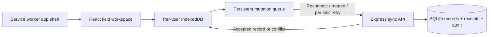

# Architecture

## Data flow



The app is same-origin: Express serves both the production frontend and `/api`. Vite is only a build/development dependency. The database is a local SQLite file opened with Node 24's built-in SQLite driver, with WAL enabled. Production assets are precached by a build-specific service worker; API responses are never put in the service worker's cache.

## Records

`records` stores `(entity, id, owner_id, version, data, updated_at)` for HCPs, SKUs, planned calls, and engagements. `data` is a validated JSON document. It includes small image data URLs for engagement photos/signatures. Future large-scale attachment storage should separate binaries into object storage and sync metadata incrementally.

Other tables:

- `users`: email, display name, salted scrypt password hash, role, active flag.
- `sessions`: SHA-256 digest of a random session token, user ID, expiry. Cookies are HTTP-only, same-site strict, optionally secure. Sessions last 14 days and are revoked on password change, deactivation, and logout.
- `receipts`: `(user_id, mutation_id)` plus request hash and accepted response. These make retrying an accepted mutation safe, including a lost response after commit.
- `audit`: accepted mutation user, entity, record ID, version, and server timestamp. This is an operational audit index, not a full historical content archive.

Unique SQLite indexes enforce approved masterlist source IDs and case-insensitive SKU codes. Record IDs are UUIDs generated before uploading, so offline references remain stable.

## Access model

- Admins can view all records, manage users, import/approve HCPs, and maintain SKUs.
- Medreps can read approved HCPs, all SKUs, and their own non-masterlist HCPs, plans, and engagements.
- Medreps cannot modify approved masterlist records or records owned by other users.
- Users record their own engagements and plan their own calls; admins may edit others' uncompleted plans.
- Engagements cannot be overwritten once accepted. Every sync request is validated and authorized on the server; UI permissions are only convenience.
- API mutations require a custom same-origin header. Cross-site browser requests are rejected, CORS is not enabled, and cookies use SameSite=Strict. A production content-security policy prevents external scripts and framing. CSV export escapes spreadsheet formula prefixes.

## Offline mutation protocol

1. In one IndexedDB transaction, save the optimistic record and append an outbox item containing a UUID mutation ID, entity, record ID, base version, and payload.
2. Queue items preserve edit order. Additional local edits advance the optimistic version and create separate mutations.
3. The sync coordinator verifies the online session matches the local account, then processes queued items. Web Locks serialize sync between tabs where supported; server receipts protect duplicate transmission in all cases.
4. The server checks prior receipts first, validates the payload and references, checks authorization and base version, and commits the record, receipt, and audit entry in one SQLite transaction.
5. An accepted response removes only its own queue item. It replaces the optimistic record only if no later local mutation superseded it.
6. A `409` with current server content creates a visible conflict. Subsequent changes to that record wait. Choosing local content rebases the latest local edit on the reviewed server version; choosing server content removes the conflicting local queue for that record.
7. Validation and permission errors stay visible. Correction replaces rejected queued changes with a new mutation ID at the rejected base version. Network failures leave the original mutation unchanged for safe retry.
8. A pull merges visible server records without overwriting queued local records. Revoked records disappear locally on a successful pull, unless unsynced work still needs resolution.

Per-user IndexedDB stores: `records`, `outbox`, `drafts`, and `meta` (last successful sync). The cached profile in localStorage allows reopening a previously signed-in workspace offline. Passwords and session tokens are not stored there.

The service worker only handles static assets/navigation. Its optional `sync` message handler can wake open clients; it does not promise closed-app synchronization. Application code triggers sync on save, reconnect, visibility, and retry intervals.

## API

All bodies and responses are JSON. Mutating requests include `X-PSL-Client: 1` and `Content-Type: application/json`.

| Method / route | Purpose |
| --- | --- |
| `GET /api/health` | Process health. |
| `POST /api/auth/login` | Email/password sign-in; creates cookie session. |
| `GET /api/auth/me` | Current active user. |
| `POST /api/auth/logout` | Revoke current session. |
| `POST /api/auth/password` | Verify current password, change password, revoke sessions. |
| `GET /api/records` | All records accessible to the current user and server timestamp. |
| `POST /api/sync` | Apply one idempotent, versioned mutation. |
| `GET /api/users` | Admin account listing. |
| `POST /api/users` | Admin account creation. |
| `PATCH /api/users/:id` | Admin activation/deactivation. |

Mutation shape:

```json
{
  "mutationId": "client-generated-uuid",
  "entity": "hcps",
  "id": "record-uuid",
  "baseVersion": 0,
  "data": { "name": "…" }
}
```

The example omits required entity fields; authoritative validation is in `server/schema.js`. `0` means create. Successful responses contain `record`; conflicts contain `error` and `current`. Sync dates are assigned by the server and never taken from client input. Actual engagement timestamps come from the client timer.

## Intended next integration work

Obtain an authoritative masterlist sample and IDs; confirm Medretailers mapping/validation APIs; approve sample SKUs and stock rules; confirm targets, plan approvals, and any restrictions on duration edits. At larger scale, introduce incremental cursors, attachment object storage, paging/search, an operational retention policy, and a proper schema migration framework. None of these external integrations is simulated as verified data.
